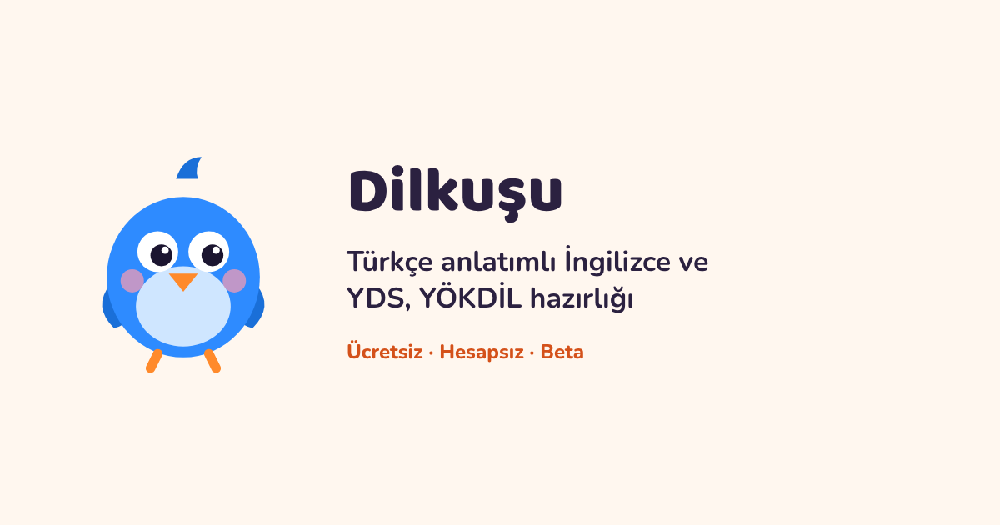

# İngilizce Öğrenme Atölyesi

**A1–C2 İngilizce öğrenme ve YDS, e-YDS, YÖKDİL hazırlık uygulaması.**

Türkçe konuşan kullanıcıların seviyelerine uygun içeriği bulmasını, kelimeleri aralıklı tekrar etmesini ve ilerlemelerini tek uygulamada takip etmesini sağlar. Ücretsiz beta sürümü hesap açmadan tarayıcıda çalışır.

[Proje tanıtımı](https://ingilizce-atolyesi.ysfdurak.com/tanitim/) · [Uygulama](https://ingilizce-atolyesi.ysfdurak.com/) · [Hakkında ve gizlilik](https://ingilizce-atolyesi.ysfdurak.com/hakkinda.html)


## İngilizce tanıtım turu

Uygulama Türkçe konuşanlar için yazıldığından arayüz Türkçe kalır. İngilizce okuyan ziyaretçi için adresin sonuna `?lang=en` eklenir: [ingilizce-atolyesi.ysfdurak.com/?lang=en](https://ingilizce-atolyesi.ysfdurak.com/?lang=en). Her bölümü anlatan bir rehber paneli açılır, menü ve başlıkların altında küçük İngilizce karşılıklar görünür; `?lang=tr` kapatır. Ayrıntı: [docs/INGILIZCE-TUR.md](docs/INGILIZCE-TUR.md).

## Uygulamada neler var?

| Çalışma alanı | İçerik |
| --- | --- |
| A1–C2 müfredatı | 75 tema ünitesi ve 193 dilbilgisi konusu |
| Kelime ve bağlam | 15.000'den fazla kelime ve kalıp, 155 hikâye, 175 diyalog ve dinleme etkinlikleri |
| Tekrar ve ilerleme | Aralıklı tekrar, tarayıcıda saklanan ilerleme ve dosyadan yedekleme |
| Sınav hazırlığı | YDS, e-YDS ve YÖKDİL için özgün denemeler ve 4.702 kayıtlı sınav sözlüğü |

## Dinlemede kaçırılan kelime (Kasım 2026)
Dinleme sorusunda yanlış şık seçilince kelime yavaş okunur ve "Kaçırdığın kelime" kutusunda yeniden, yavaş ve cümle içinde dinleme düğmeleri çıkar (`missBox`). Derste aynı kelime iki adım sonra boşluk doldurma olarak yeniden sorulur (`lsNext`). Cümle, `altSent()` ile seçilir: kelimenin aynı biçimini içeren, öğrencinin seviyesini en çok bir basamak aşan **başka** bir kelimenin örnek cümlesi; yoksa kelimenin kendi örneği (ekrandaki not buna göre değişir).

## Portföydeki yeri

Yusuf Durak ürün kapsamını, seviye bazlı öğrenme akışını ve sınav hazırlığı bölümünü belirledi. Kod ve öğrenme içeriği yapay zekâ desteğiyle geliştirildi.

HTML, CSS ve JavaScript ile hazırlanan statik uygulama derleme gerektirmez. Çalışma akışı `app.js` dosyasında, tanıtım `tanitim/` altında, statik içerik sayfaları `dilbilgisi/` ve `yds-kelimeleri/` altında bulunur. Service worker ve web manifesti PWA desteğini sağlar.

## English

**İngilizce Öğrenme Atölyesi** (English Learning Workshop) is an A1–C2 English learning and YDS, e-YDS and YÖKDİL exam-prep app for Turkish speakers. It runs in the browser without an account.

- **Try it:** https://ingilizce-atolyesi.ysfdurak.com/?lang=en — explanations, feedback and exam prep are in Turkish, so the interface stays in Turkish; `?lang=en` opens a guide that explains each section, with small English labels under the menus.
- **Content:** a daily plan built from goal, daily time and level; 75 themed units and 193 grammar topics; over 15,000 words and collocations; 155 stories and 175 dialogues; spaced review (10 minutes, 1, 3, 7 and 21 days); original YDS, e-YDS and YÖKDİL practice tests and a 4,702-entry exam glossary.
- **Privacy:** progress stays in the browser and can be backed up to a file; installable on a phone (PWA).
- **Stack:** static HTML, CSS and JavaScript with no build step (`app.js`, service worker, web manifest).

## Yerelde çalıştırma

Depo kökünde şu komutu çalıştır.

```sh
python -m http.server 8000
```

[Uygulamayı](http://localhost:8000/) veya [tanıtım sayfasını](http://localhost:8000/tanitim/) aç. Canlı adres **ingilizce-atolyesi.ysfdurak.com** (Cloudflare Workers, `main` dalına her push'ta otomatik yayın; ayarlar `wrangler.jsonc`). Eski GitHub Pages adresi açık kalır; `tasima.js` ziyaretçiyi ilerlemesiyle birlikte yeni adrese gönderir.

## Kayıtlar, içerik ve lisans

İlerleme tarayıcıda saklanır. Profil üzerinden yedek alabilir ve önceki sürümlerin yedeklerini yükleyebilirsin. İçerik beta aşamasında ve kapsamlı öğretmen incelemesi bekliyor. Denemeler uygulamaya özel hazırlandı. Lisans aşağıda; üçüncü taraf kaynak koşulları için [UCUNCU-TARAF.md](UCUNCU-TARAF.md) dosyasına bak.

## Lisans

Bu proje [PolyForm Shield 1.0.0](LICENSE.md) lisansıyla yayınlanır. Kaynak kodu açıktır, ancak resmi anlamda bir "açık kaynak" lisansı değildir.

- **Serbest:** Kişiler, okullar ve şirketler kendi işlerinde ücretsiz kullanabilir, değiştirebilir ve kendi bilgisayarlarına ya da sunucularına kurabilir. İzin almak gerekmez.
- **Yazılı izin gerekir:** Yazılımı satmak, adını değiştirip ürün gibi sunmak ya da bununla (ücretsiz olsa bile) rakip bir ürün veya hizmet sunmak.
- **Garanti yok:** Yazılım olduğu gibi sunulur. Bağlayıcı olan İngilizce lisans metnidir.
- Üçüncü taraf bileşenler kendi lisanslarına tabidir.
- Kelime listeleri gibi üçüncü taraf kaynaklar ve koşulları: [UCUNCU-TARAF.md](UCUNCU-TARAF.md).

Kurumunuzda kullanıyorsanız haber verirseniz sevinirim: kurulumda yardımcı olabilir, kurumunuza özel ihtiyaçları birlikte değerlendirebiliriz. İletişim: iletisim@ysfdurak.com

### License (English)

Released under [PolyForm Shield 1.0.0](LICENSE.md). The source is available, but this is not an OSI "open source" licence.

- **Free:** individuals, schools and companies may use it in their own work, change it and run it on their own computers or servers. No permission needed.
- **Needs written permission:** selling it, rebranding it as a product, or providing a product or service that competes with it (even free of charge).
- **No warranty:** provided as is. The English licence text is binding.
- Third-party components keep their own licences.
- Third-party sources such as word lists and their terms: [UCUNCU-TARAF.md](UCUNCU-TARAF.md).

Using it in your organisation? I'd be glad to hear from you: I can help with setup and look at your organisation's needs together. Contact: contact@ysfdurak.com
