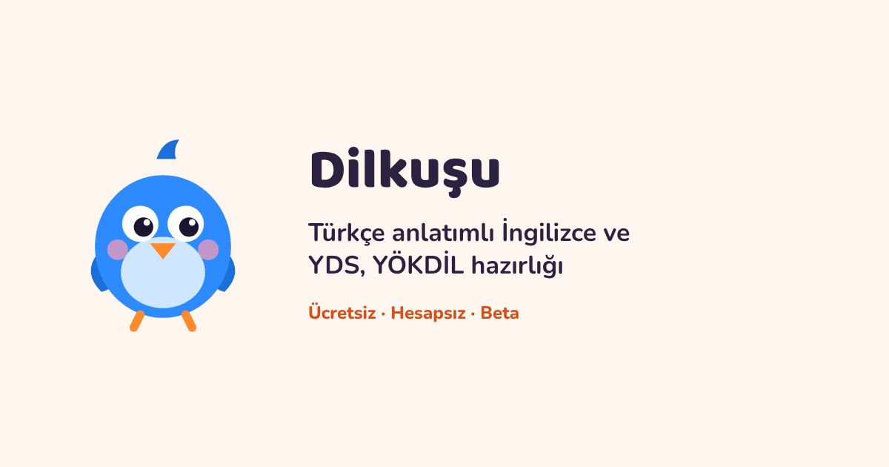

# İngilizce Öğrenme Atölyesi

**A1–C2 İngilizce öğrenme ve YDS, e-YDS, YÖKDİL hazırlık uygulaması.**

Türkçe konuşan kullanıcıların seviyelerine uygun içeriği bulmasını, kelimeleri aralıklı tekrar etmesini ve ilerlemelerini tek uygulamada takip etmesini sağlar. Ücretsiz beta sürümü hesap açmadan tarayıcıda çalışır.

[Proje tanıtımı](https://ysfdurak.github.io/ingilizce-ogrenme-atolyesi/tanitim/) · [Uygulama](https://ysfdurak.github.io/ingilizce-ogrenme-atolyesi/) · [Hakkında ve gizlilik](https://ysfdurak.github.io/ingilizce-ogrenme-atolyesi/hakkinda.html)


## Uygulamada neler var?

| Çalışma alanı | İçerik |
| --- | --- |
| A1–C2 müfredatı | 75 tema ünitesi ve 193 dilbilgisi konusu |
| Kelime ve bağlam | 15.000'den fazla kelime ve kalıp, 155 hikâye, 175 diyalog ve dinleme etkinlikleri |
| Tekrar ve ilerleme | Aralıklı tekrar, tarayıcıda saklanan ilerleme ve dosyadan yedekleme |
| Sınav hazırlığı | YDS, e-YDS ve YÖKDİL için özgün denemeler ve 4.702 kayıtlı sınav sözlüğü |

## Portföydeki yeri

Yusuf Durak ürün kapsamını, seviye bazlı öğrenme akışını ve sınav hazırlığı bölümünü belirledi. Kod ve öğrenme içeriği yapay zekâ desteğiyle geliştirildi.

HTML, CSS ve JavaScript ile hazırlanan statik uygulama derleme gerektirmez. Çalışma akışı `app.js` dosyasında, tanıtım `tanitim/` altında, statik içerik sayfaları `dilbilgisi/` ve `yds-kelimeleri/` altında bulunur. Service worker ve web manifesti PWA desteğini sağlar.

## Yerelde çalıştırma

Depo kökünde şu komutu çalıştır.

```sh
python -m http.server 8000
```

[Uygulamayı](http://localhost:8000/) veya [tanıtım sayfasını](http://localhost:8000/tanitim/) aç. GitHub Pages kaynak ayarı `main` dalı ve `/ (root)` klasörüdür.

## Kayıtlar, içerik ve lisans

İlerleme tarayıcıda saklanır. Profil üzerinden yedek alabilir ve önceki sürümlerin yedeklerini yükleyebilirsin. İçerik beta aşamasında ve kapsamlı öğretmen incelemesi bekliyor. Denemeler uygulamaya özel hazırlandı. Kullanım ve üçüncü taraf kaynak koşulları için [lisansa](LICENSE.md) bak.
